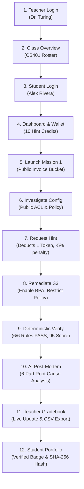

# CloudProof Presentation & Demonstration Guide

This guide provides the complete demonstration script, presentation cheat sheet, and operational walkthrough for presenting **CloudProof** to academic review boards, faculty advisors, industry judges, and students.

---

## 1. The 3-Minute Elevator Pitch

> *"Most university cloud computing courses teach students how to build and deploy applications, but they rarely teach them how to handle cloud security incidents when things go wrong. In production, over 80% of major cloud breaches—from Capital One to massive enterprise data leaks—are caused by misconfigurations in IAM, S3 storage, and VPC security groups.*
>
> *CloudProof bridges this critical education gap with an interactive incident practice platform built on an active learning loop: **Learn → Practice → Break → Investigate → Fix → Verify → Understand → Prove**.*
>
> *Two key innovations set CloudProof apart:*
> 1. *Deterministic Grading Separation:* AI **never** grades or scores student solutions. 100% of evaluation is performed deterministically by custom rule engines. AI is strictly harnessed to generate grounded 6-part incident post-mortems.
> 2. *Dual Execution Modes:* A zero-cloud-cost local simulation mode for campus computer labs, paired with a turnkey Real AWS mode using read-only STS AssumeRole with external IDs and zero stored static access keys."*

---

## 2. Quick Demo Credentials Cheat Sheet

Run this single command before any presentation to initialize a clean demo environment:
```bash
python scripts/seed_demo.py --clean
```

| Role | Name | Email | Password | Role Purpose |
| :--- | :--- | :--- | :--- | :--- |
| **Faculty Instructor** | Dr. Alan Turing | `dr.turing@college.edu` | `DemoInstructor123!` | Manages CS401, views analytics, exports grades |
| **Demo Student** | Alex Rivera | `student@college.edu` | `DemoStudent123!` | Hero student for live onstage remediation |
| **Peer Student (Advanced)** | Alice Chen | `alice.chen@college.edu` | `StudentPass123!` | Completed 2 missions, populates class gradebook |
| **Peer Student (Intermediate)** | Bob Smith | `bob.smith@college.edu` | `StudentPass123!` | Partial progress, demonstrates hint usage |

- **Active Classroom:** `CS401: Cloud Infrastructure Security & Incident Response`
- **Class Join Code:** `SEC401`

---

## 3. The 12-Stage Live Demonstration Flow



### Detailed Presentation Script

#### Stage 1: Faculty Authentication
- Navigate to `http://localhost:3000/login`
- Log in as `dr.turing@college.edu` / `DemoInstructor123!`
- **Talking Point:** Role-based access control automatically routes instructors to the institutional command center.

#### Stage 2: Class Management & Mission Catalog
- View `CS401: Cloud Infrastructure Security & Incident Response` (Join code: `SEC401`).
- Show the 3 curated incident tracks:
  1. **Storage Security:** *The Public Invoice Bucket*
  2. **Identity & Access Management:** *The Overprivileged Lambda Role*
  3. **Network Security & VPC:** *The World-Readable Database Port*
- **Talking Point:** Instructors can assign pre-built incidents covering the top 3 OWASP Cloud Top 10 vulnerabilities with turnkey CloudFormation templates.

#### Stage 3 & 4: Student Login & Hint Token Economy
- Log in in an incognito window as `student@college.edu` / `DemoStudent123!`
- Notice the **Daily Hint Wallet (10 virtual tokens)**.
- **Talking Point:** To encourage independent critical thinking, hints are not free. A tiered hint token economy balances student struggle with guidance without microtransactions.

#### Stage 5 & 6: Launch & Investigate Incident
- Launch Mission 1 ("The Public Invoice Bucket") in Simulation Mode.
- Inspect the interactive Infrastructure Inspector:
  - S3 Block Public Access (all 4 flags: `False`)
  - Bucket ACL (`public-read`)
  - Bucket Policy allows unconditional anonymous `s3:GetObject` with `Principal: "*"`.
- **Talking Point:** Students inspect realistic infrastructure states directly in the browser with zero cloud bills.

#### Stage 7: Pedagogical Hint Request
- Click **Unlock Hint (Tier 1: Conceptual Direction)**.
- Observe token deduction (Balance: 9 tokens) and scoring penalty indicator (-5%).
- Hint explains the relationship between ACLs, Policies, and BPA controls.

#### Stage 8: Remediate Configuration
- Use the remediation controls to enable all 4 Block Public Access settings:
  - `BlockPublicAcls: True`, `IgnorePublicAcls: True`, `BlockPublicPolicy: True`, `RestrictPublicBuckets: True`
- Scope the bucket policy to require authenticated worker role execution.
- Set Bucket ACL to `private`.

#### Stage 9: Deterministic Rule Verification
- Click **Verify Remediations**.
- The deterministic Rule Engine evaluates all 6 security checks in under 50ms:
  - `CP-S3-001` through `CP-S3-006` all return **PASS**.
  - Final Grade: **95/100** (100 base points - 5 hint penalty).
- **Core Principle:** Highlight that AI did NOT grade this. Deterministic Python rules evaluated the exact configuration against cloud security benchmarks.

#### Stage 10: Grounded 6-Part AI Post-Mortem
- The AI Incident Post-Mortem card renders immediately:
  1. *Root Cause Analysis*
  2. *Threat Model & Blast Radius*
  3. *Remediation Explanation*
  4. *Defensive Engineering Principle*
  5. *Real-World Industry Breach Reference (e.g., Capital One, Accenture S3 leak)*
  6. *Deterministic Verification Proof*
- **Talking Point:** Students don't just fix a checkbox—they understand the defensive architecture and why the fix works in enterprise environments.

#### Stage 11: Real-Time Instructor Gradebook & CSV Export
- Switch back to Dr. Turing's dashboard.
- Observe Alex Rivera's score updated to **95%** in real-time.
- Click **Export Grades (CSV)** to show turnkey LMS export compatibility for Canvas, Blackboard, and Moodle.

#### Stage 12: Student Verified Portfolio & Certification Attestation
- Open Alex Rivera's **Portfolio** (`/student/portfolio`).
- View the **Storage Security: Mastered (95%)** competency card.
- Showcase the **Digital Certificate Badge** with its cryptographic SHA-256 verification hash (`CP-VERIFY-{hash}`), ready to share on LinkedIn or student resumes.

---

## 4. Automated Demonstration CLI Runner

For hands-free presentations or continuous integration verification, run the turnkey demonstration runner:

```bash
# Automated non-interactive walkthrough
python scripts/demo_walkthrough.py --in-memory

# Interactive step-by-step walkthrough (press Enter between stages)
python scripts/demo_walkthrough.py --base-url http://localhost:8000/api/v1
```
