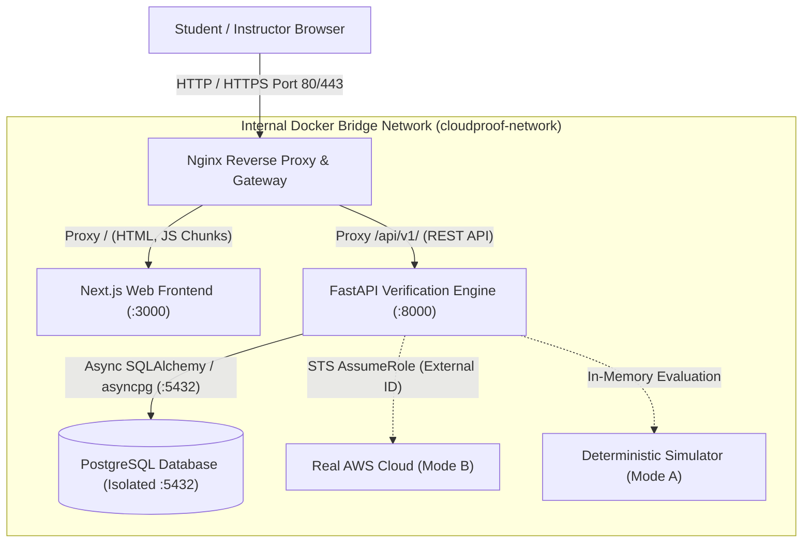

# CloudProof Production Deployment & Operations Guide

This guide details the containerized deployment architecture, network topology, security isolation, and operational procedures for **CloudProof**.

---

## 1. Architecture Topology

In production, CloudProof follows a defense-in-depth, reverse-proxied container topology where internal database ports and backend services are not exposed to the public internet:



### Key Security Isolations
1. **Zero Public Database Exposure:** Port `5432` is strictly bound to `cloudproof-network` and is never mapped to host interfaces in production.
2. **Unified Origin:** Nginx terminates web traffic and routes `/api/` to backend and `/` to frontend, eliminating cross-origin security overhead and CORS preflight latency.
3. **Automated Health Chaining:** The frontend only starts after the backend reports healthy (`/api/v1/health`), and the backend only boots after PostgreSQL passes `pg_isready`.

---

## 2. Deployment Profiles

CloudProof supports three distinct deployment profiles tailored for college labs and production environments:

| Deployment Profile | Target Use Case | Database | Cloud Cost | Docker Required | Command |
| :--- | :--- | :--- | :--- | :--- | :--- |
| **Profile A: Production Stack** | Institutional hosting, server deployment | PostgreSQL 16 | $0.00 | Yes | `./scripts/deploy.sh --prod` |
| **Profile B: Campus Lab Mode** | Low-RAM student laptops, computer labs | SQLite | $0.00 | Yes | `./scripts/deploy.sh --sqlite` |
| **Profile C: Bare Metal Dev** | Development, offline without Docker | SQLite | $0.00 | No | Manual python / npm |

---

## 3. Quickstart Deployment Instructions

### Profile A: Full Production Deployment (Nginx + PostgreSQL)

1. **Clone the repository:**
   ```bash
   git clone https://github.com/cloudproof/cloudproof.git
   cd cloudproof
   ```

2. **Initialize production environment variables:**
   ```bash
   cp .env.production.example .env.production
   ```
   Generate a cryptographic JWT secret:
   ```bash
   openssl rand -hex 32
   ```
   Paste the generated value into `JWT_SECRET` in `.env.production`.

3. **Deploy with turnkey script:**
   - **Linux / macOS:**
     ```bash
     chmod +x scripts/deploy.sh
     ./scripts/deploy.sh --prod
     ```
   - **Windows:**
     ```powershell
     .\scripts\deploy.ps1 -Mode Prod
     ```

4. **Verify Deployment:**
   - Web Platform: `http://localhost`
   - Health Probe: `http://localhost/api/v1/health`
   - Nginx Status: `http://localhost/nginx-health`

---

### Profile B: Zero-Cost College Lab Deployment (SQLite)

Designed for single-machine student lab workstations with constrained memory:

1. **Deploy with turnkey script:**
   - **Linux / macOS:**
     ```bash
     ./scripts/deploy.sh --sqlite
     ```
   - **Windows:**
     ```powershell
     .\scripts\deploy.ps1 -Mode Sqlite
     ```

2. **Access endpoints:**
   - Web Platform: `http://localhost:3000`
   - Backend API: `http://localhost:8000/api/v1/health`
   - Database persisted locally in `./data/cloudproof.db`

---

### Profile C: Standalone Local Execution (Without Docker)

If Docker is unavailable on campus lab machines:

1. **Backend Service:**
   ```bash
   cd backend
   python -m venv .venv
   source .venv/bin/activate  # Or: .venv\Scripts\Activate.ps1 on Windows
   pip install -r requirements.txt
   uvicorn app.main:app --host 0.0.0.0 --port 8000
   ```

2. **Frontend Service (in separate terminal):**
   ```bash
   cd frontend
   npm install
   npm run build
   npm start
   ```

---

## 4. Operational Maintenance & Monitoring

### Container Health Status
Inspect real-time health checks of running containers:
```bash
./scripts/deploy.sh --status
# Or Windows:
.\scripts\deploy.ps1 -Action Status
```

### Streaming Logs
Follow real-time container output:
```bash
./scripts/deploy.sh --logs
```

### Clean Teardown
Stop and remove all running CloudProof containers without losing persisted data:
```bash
./scripts/deploy.sh --down
# Or Windows:
.\scripts\deploy.ps1 -Action Down
```

---

## 5. Database Backup & Disaster Recovery

### PostgreSQL Backup (Profile A)
```bash
docker exec -t cloudproof-postgres-prod pg_dump -U cloudproof_admin cloudproof_production > backup_$(date +%Y%m%d).sql
```

### PostgreSQL Restore (Profile A)
```bash
cat backup_20261011.sql | docker exec -i cloudproof-postgres-prod psql -U cloudproof_admin -d cloudproof_production
```

### SQLite Backup (Profile B)
Simply copy the persisted database file:
```bash
cp data/cloudproof.db data/cloudproof_backup_$(date +%Y%m%d).db
```
