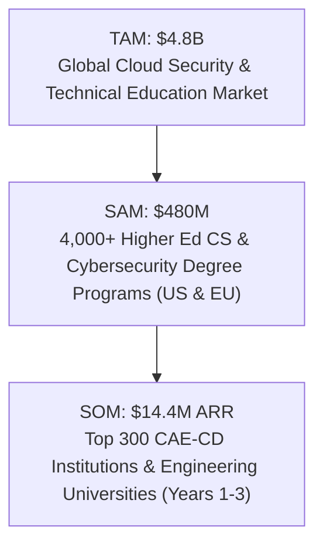
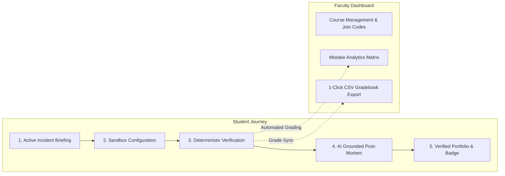
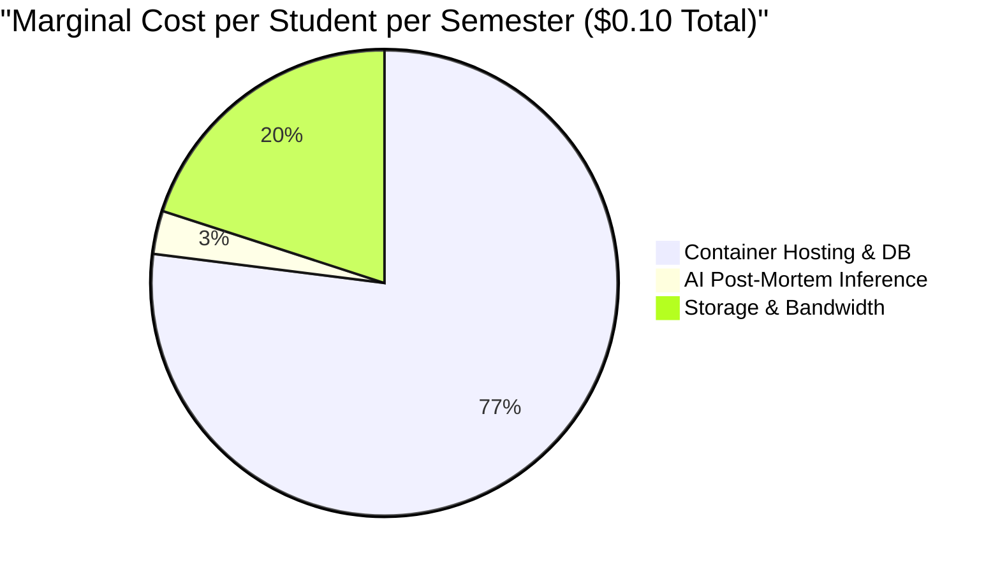
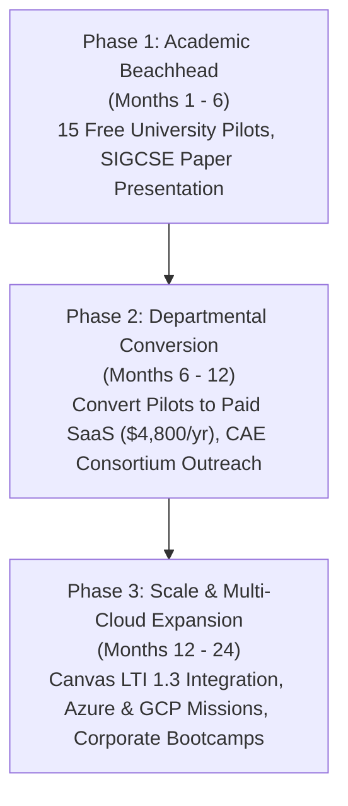

# CloudProof: Startup Validation, Unit Economics & Commercialization Plan

**Company:** CloudProof, Inc.  
**Tagline:** The Automated Cloud Incident Learning & Verification Platform for Higher Education  
**Document Classification:** Internal Investor Memorandum & Strategic Commercialization Plan  
**Target Market:** Higher Education (Colleges & Universities), Cybersecurity Centers of Academic Excellence (CAE), and Enterprise Upskilling Bootcamps  

---

## Executive Summary

Cloud computing misconfigurations account for more than $80\%$ of enterprise data breaches, creating a global deficit of over 4 million cybersecurity professionals. Yet, higher education computer science and cybersecurity departments are systematically unable to deliver authentic, hands-on cloud incident response education. Instructors face an impossible trilemma:
1. **Passive Theory:** Assign dry, multiple-choice quizzes and static PDF walkthroughs that fail to develop diagnostic troubleshooting skills.
2. **Financial Liability:** Provide live AWS accounts that expose departments to unpredictable "bill shock" (students inadvertently leaving GPU clusters or NAT gateways running overnight).
3. **Evaluative Chaos:** Rely on emergent LLM-as-a-judge grading tools that hallucinate scores, produce inconsistent grades, and remain vulnerable to student prompt injection.

**CloudProof solves this trilemma.** By enforcing strict physical separation between a **deterministic rule verification engine** and **grounded generative AI post-mortems**, CloudProof provides an authentic, high-impact learning workbench with **$0 student cloud costs**, **zero grading hallucinations**, and **automated gradebook integration**.

---

## 1. The Market Opportunity & Total Addressable Market (TAM)

### 1.1 Market Sizing Breakdown
* **Total Addressable Market (TAM) — \$4.8 Billion:**  
  The global market for cloud security training, technical cyber labs, and collegiate instructional software across academia and enterprise training.
* **Serviceable Addressable Market (SAM) — \$480 Million:**  
  Over 4,000 accredited universities and colleges across North America and Europe offering degrees in Computer Science, Information Technology, Cybersecurity, and Cloud Engineering. Average departmental software budget: $\$15,000 - \$45,000$ annually.
* **Serviceable Obtainable Market (SOM) — \$14.4 Million ARR (Years 1–3):**  
  Initial beachhead: 300 National Centers of Academic Excellence in Cyber Defense (CAE-CD), ABET-accredited engineering programs, and leading cloud security bootcamps averaging $\$4,800$ per department annually.

### 1.2 Macro Growth Tailwinds
1. **Mandatory Hands-On Curriculum Requirements:** ABET, NSA CAE-CD, and NICE Workforce Frameworks increasingly mandate measurable, hands-on competency verification over passive multiple-choice testing.
2. **Student Debt & Affordability Pressures:** Universities face intense scrutiny over lab fees and textbook costs. CloudProof's guaranteed **$0 student cost model** is a major institutional selling point.
3. **Enterprise Hiring Demand for "Proof of Skill":** Employers no longer trust multiple-choice certifications. CloudProof's cryptographically verifiable student skills portfolio provides tangible proof of hands-on remediation ability.

---

## 2. The CloudProof Solution & Pedagogical Loop

CloudProof transforms passive curriculum into an active incident response flight simulator:

$$\text{Learn} \longrightarrow \text{Practice} \longrightarrow \text{Break} \longrightarrow \text{Investigate} \longrightarrow \text{Fix} \longrightarrow \text{Verify} \longrightarrow \text{Understand} \longrightarrow \text{Prove}$$

### Key Technical Differentiators:
1. **The AI Separation Rule:** Grading is 100% deterministic (evaluated via programmatic Python rule packs in $<50$ ms). The AI layer receives verified outcomes as read-only context to synthesize realistic 6-part incident post-mortems. Zero grading hallucinations.
2. **Dual-Mode Architecture:**
   - **Mode A (Simulation):** Zero-cost, instantaneous in-memory execution for introductory labs.
   - **Mode B (Real AWS):** Automated live verification using cross-account STS `AssumeRole` with External ID conditions. No long-lived static AWS credentials are ever stored.
3. **Tiered Virtual Hint Economy:** Students spend daily virtual tokens to unlock hierarchical hints (Architectural Overview $\rightarrow$ Investigative Angle $\rightarrow$ Near-Solution $\rightarrow$ Exact Syntax) with tiered score deductions, reinforcing independent problem-solving.

---

## 3. Business Model & Departmental SaaS Pricing

CloudProof operates on a **B2B Institutional SaaS model**. Students never pay a penny; licensing fees are absorbed by departmental software or lab fees.

| Tier | Annual Price | Student Capacity | Target Customer | Core Features Included |
|---|---|---|---|---|
| **Course Starter** | **\$1,500 / year** | Up to 100 students | Single Course / Adjunct Faculty | 3 Core Mission Packs (S3, IAM, VPC), Local Simulation Mode, Gradebook CSV Export, Virtual Hint Economy |
| **Department / CAE** *(Flagship)* | **\$4,800 / year** | Up to 500 students | Academic Departments / Centers of Excellence | Unlimited Courses, All Current & Future Missions, Real AWS Multi-Account Verification Mode, AI Post-Mortems (Gemini API), De-identified Research Dataset Export |
| **Campus Enterprise** | **\$12,000 / year** | Unlimited students | Multi-Campus Universities / Consortia | Canvas/Blackboard LTI 1.3 LMS Integration, Custom Mission Authoring SDK, Dedicated Hosting, SSO/SAML, Executive SLA |

---

## 4. Unit Economics & Financial Projections

CloudProof exhibits software margins with minimal marginal cost per student due to its efficient local simulation engine and serverless backend architecture.

### 4.1 Cost of Goods Sold (COGS) Breakdown per Student per Semester

1. **Compute & Database (PostgreSQL + FastAPI + Next.js):**  
   A modest container cluster (\$40/month on AWS ECS or shared campus server) comfortably supports 500 active students concurrently executing simulations.  
   $$\text{Compute Cost} = \frac{\$40 \times 4\text{ months}}{500\text{ students}} \approx \mathbf{\$0.32}\text{ per student-year} \implies \mathbf{\$0.077}\text{ per student-semester}$$

2. **AI Post-Mortem Generation (Google Gemini 3.8 Flash):**  
   - Average student completes 4 missions per semester, generating $\approx 5$ post-mortems each (including iterative retries) = 20 generation calls.
   - Token volume per post-mortem: $\approx 1,200$ prompt tokens + $600$ completion tokens.
   - Gemini Flash pricing: $\$0.075 / 1\text{M}$ input tokens, $\$0.30 / 1\text{M}$ output tokens.
   - Cost per call: $(0.0012 \times \$0.075) + (0.0006 \times \$0.30) = \$0.00009 + \$0.00018 = \$0.00027$.
   - Semester total: $20 \times \$0.00027 \approx \mathbf{\$0.0054}\text{ per student}$ (or $\$0.00$ with built-in offline deterministic provider).

3. **Storage & Bandwidth:**  
   $$\text{Bandwidth \& Verification Storage} \approx \mathbf{\$0.02}\text{ per student-semester}$$

$$\mathbf{\text{Total COGS per Student per Semester}} = \$0.077 + \$0.0054 + \$0.020 \approx \mathbf{\$0.102}\text{ per student}$$

---

### 4.2 Gross Margin Analysis

For a typical **Department Tier Subscription (\$4,800/year, 500 students)**:
* Annual Revenue: $\$4,800.00$
* Annual Student COGS: $500 \times (\$0.102 \times 2\text{ semesters}) = \$102.00$
* Annual Infrastructure Buffer: $\$100.00$
* **Total Annual COGS:** $\$202.00$
* **Gross Profit:** $\$4,598.00$
* **Gross Margin:** **$95.8\%$**

---

### 4.3 Customer Acquisition Cost (CAC) & Unit Economics Metrics

* **Blended Customer Acquisition Cost (CAC):** **\$750**  
  Driven by bottom-up instructor virality: professors publish syllabus references, present at conferences (SIGCSE, USENIX, IEEE), and adopt the open-source curriculum before converting to paid departmental licensing.
* **Average Contract Value (ACV):** **\$3,800**
* **Customer Lifetime (Academic Departments):** **4.5 years** (low churn due to curriculum integration).
* **Customer Lifetime Value (LTV):** $\$3,800 \times 95.8\% \times 4.5 \approx \mathbf{\$16,380}$
* **LTV : CAC Ratio:**  
  $$\frac{\text{LTV}}{\text{CAC}} = \frac{\$16,380}{\$750} = \mathbf{21.8\times}$$
* **Payback Period:** $< 2.5\text{ months}$.

---

## 5. Competitive Landscape & Defensibility Moat

| Platform | Target Audience | Grading Engine | Real AWS Support? | Student Cloud Cost | Instructor Roster Analytics |
|---|---|---|---|---|---|
| **CloudProof** | **Higher Ed & University Labs** | **Deterministic Rules (0% Hallucination)** | **Yes (Cross-Account STS)** | **$0.00 Guaranteed** | **Yes (Real-time Matrix + 1-Click CSV)** |
| *TryHackMe / HackTheBox* | Self-Study Gamers | Flag capture (`grep flag{...}`) | No (Isolated Linux VMs) | Subscription (\$14/mo) | Minimal academic analytics |
| *RangeForce / Immersive Labs* | Fortune 500 SOC Teams | Scripted checkpoints | Limited | High (\$3,000+ / seat) | Tailored to enterprise compliance |
| *AWS Skill Builder* | Individual Practitioners | Proprietary cloud checks | AWS Only | Varies (\$29/mo) | None (Single-user focus) |
| *Generic LLM Graders* | Ad-hoc Experiments | Nondeterministic LLM prompt | No | API fees | Unreliable & vulnerable to injection |

### CloudProof's Defensible Moats:
1. **Zero-Cost Dual Mode:** Competitors either burn expensive cloud VMs or force users onto static quizzes. CloudProof runs local simulations instantly for zero cost, while retaining full capability to audit real AWS accounts.
2. **Deterministic Grading Separation:** Pedagogical credibility in academia requires reproducible, mathematically sound grades. CloudProof is immune to LLM hallucination.
3. **Curriculum Stickiness:** Once an engineering department integrates CloudProof missions into their accredited syllabus and LMS, switching costs are exceptionally high.
4. **Verifiable Student Portfolio:** Every completed mission generates a cryptographically signed verification badge that students link on resumes and LinkedIn, creating an organic brand flywheel across employers.

---

## 6. Go-To-Market (GTM) Strategy & Execution Roadmap

### Phase 1 (Months 1–6): Academic Beachhead & Faculty Advocacy
- Publish empirical research findings at premier computer science education venues (SIGCSE, USENIX ASE).
- Onboard 15 initial university pilot courses using the turnkey demo and automated evaluation harness.
- Provide participating faculty with co-authorship opportunities using de-identified IRB/FERPA-compliant dataset exports.

### Phase 2 (Months 6–12): Paid SaaS Conversion & CAE Expansion
- Convert pilot departments to annual subscriptions ($1,500 – $4,800/year).
- Partner with National Centers of Academic Excellence in Cybersecurity (CAE-CD) working groups.
- Release declarative Mission Authoring SDK enabling faculty to publish and share custom university incidents.

### Phase 3 (Months 12–24): Platform Scaling & Enterprise Bootcamps
- Launch certified LTI 1.3 Canvas and Blackboard integration for seamless grade sync.
- Expand declarative incident packs to Microsoft Azure (RBAC & Storage) and Google Cloud Platform (IAM & Cloud Storage).
- Offer enterprise cloud incident response upskilling to corporate cybersecurity bootcamps.

---

## 7. 10-Slide Investor Pitch Deck Outline

### Slide 1: Title & Vision
* **Headline:** CloudProof — The Cloud Incident Flight Simulator for Higher Education.
* **Visual:** Platform UI displaying the interactive S3 Workbench and deterministic verification modal.
* **Pitch:** "CloudProof gives every computer science student real-world incident response experience without risking departmental cloud bills."

### Slide 2: The Problem
* **Data Point:** Over $80\%$ of cloud breaches are configuration errors; 4M unfilled cyber roles.
* **Pain Point:** Universities cannot teach hands-on cloud defense: static labs are ineffective, live cloud accounts cause catastrophic bill shock, and AI grading bots hallucinate.

### Slide 3: The Solution
* **Tagline:** Learn $\rightarrow$ Practice $\rightarrow$ Break $\rightarrow$ Investigate $\rightarrow$ Fix $\rightarrow$ Verify $\rightarrow$ Understand $\rightarrow$ Prove.
* **Value Prop:** Real cloud incidents, deterministic grading, zero student cost, grounded AI debriefs.

### Slide 4: The Core Innovation: AI Separation Rule
* **Graphic:** Visual diagram showing deterministic rule evaluation completely decoupled from LLM debriefing.
* **Proof:** $0.0\%$ scoring hallucinations; mathematically verifiable grading.

### Slide 5: The Product & Faculty Experience
* **Key Features:** Real-time student mistake matrix, automated RFC 4180 CSV gradebook export, student verifiable skills portfolio.
* **Demo Video:** 60-second clip of remediation, instant verification, and post-mortem generation.

### Slide 6: Market Size & Opportunity
* **Numbers:** $\$4.8\text{B}$ TAM $\rightarrow$ $\$480\text{M}$ Higher Ed SAM $\rightarrow$ $\$14.4\text{M}$ Beachhead SOM across 300 CAE engineering universities.

### Slide 7: Business Model & Elite Unit Economics
* **Model:** Institutional B2B SaaS (\$1,500 – \$4,800 / year). Students pay $\$0.00$.
* **Metrics:** **$95.8\%$ Gross Margin**, $\$0.10$ COGS per student-semester, $21.8\times$ LTV:CAC ratio.

### Slide 8: Traction & Empirical Validation
* **Pilot Data ($N=20$):**
  - $46.4\%$ faster remediation ($p < 0.0001, d = -5.91$).
  - High-Gain learning mastery ($g = 0.76$ vs $0.33$).
  - $\$0.00$ student cloud spend across all cohorts.

### Slide 9: Go-To-Market Flywheel
* **Strategy:** Bottom-up professor adoption through open curriculum and academic papers $\rightarrow$ Departmental SaaS procurement $\rightarrow$ Verifiable student portfolio badges driving employer awareness.

### Slide 10: The Ask & Milestones
* **The Ask:** **\$750,000 Pre-Seed Round**.
* **Use of Funds:**
  - $50\%$ Engineering: Multi-cloud expansion (Azure / GCP) and Canvas LTI integration.
  - $30\%$ University Partnerships & Academic Relations: Scaling from 15 to 100 active university campuses.
  - $20\%$ Curriculum & Content: Expanding catalog to 25 declarative incident packs.
* **18-Month Target:** 100 paying academic departments, $\$450\text{k}$ ARR, cash-flow positive.

---

## 8. Conclusion

CloudProof bridges the critical gap between academic theory and enterprise cloud defense. By pairing zero-cost simulation with mathematically objective verification and AI-powered post-mortems, CloudProof establishes a sustainable, high-margin SaaS enterprise poised to become the definitive standard for cloud security education.
