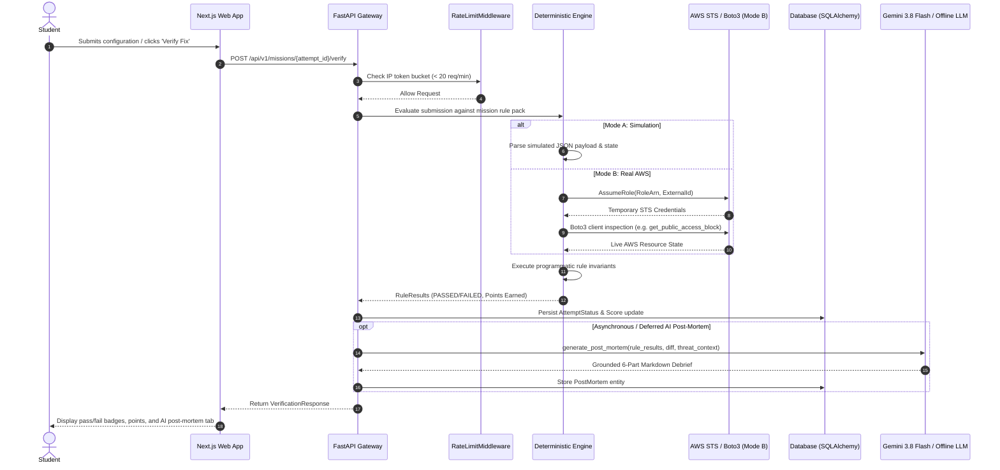

# CloudProof Data Flow & Verification Pipeline Specification

This document details the step-by-step data lifecycle during an automated mission verification cycle in both Simulation Mode (Mode A) and Real AWS Mode (Mode B).

---

## 1. End-to-End Verification Pipeline

---

## 2. Invariant Normalization Layer

To ensure identical deterministic behavior across Mode A and Mode B:

1. **State Normalizer:** The Boto3 adapter converts AWS API responses into normalized Python dictionaries matching the simulation payload structure.
2. **Boolean Strictness:** S3 BPA flags (`BlockPublicAcls`, `IgnorePublicAcls`, etc.) are coerced to strict Python booleans (`bool`), rejecting string representations like `"true"` or `"1"`.
3. **JSON Policy Canonicalization:** IAM and S3 bucket policies are parsed into canonical AST dictionaries, sorted by `Sid`, with single-element arrays normalized to lists to prevent false negatives.
