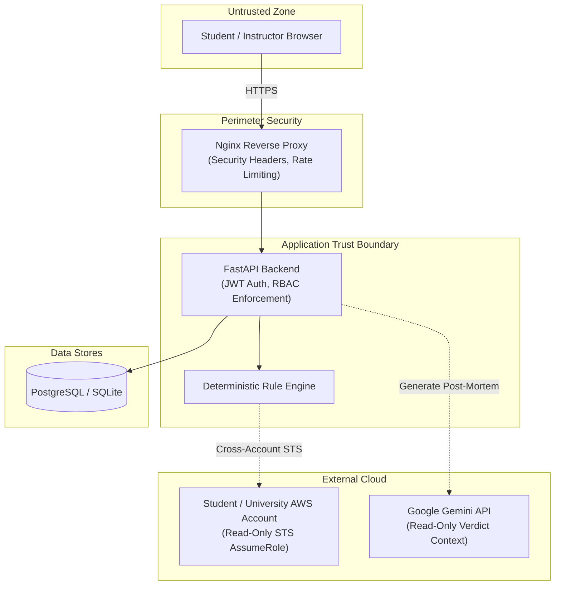

# CloudProof Threat Model & STRIDE Security Analysis

This document outlines the security architecture and threat modeling for **CloudProof** following the Microsoft STRIDE methodology (Spoofing, Tampering, Repudiation, Information Disclosure, Denial of Service, Elevation of Privilege).

---

## 1. System Context & Trust Boundaries

---

## 2. STRIDE Threat Assessment

| Threat Category | Potential Attack Vector | CloudProof Mitigation Strategy | Status |
|---|---|---|---|
| **Spoofing (Identity)** | Student impersonating faculty to modify grades or view answers | Cryptographic JWT authentication (HS256) with role claims verified at endpoint dependency layer (`RoleChecker(["instructor"])`). Passwords hashed with BCrypt. | **MITIGATED** |
| **Tampering (Data)** | Malicious student modifying rule verdicts or injecting prompt overrides | AI is physically decoupled from scoring. Rules execute in sandboxed Python logic. Adversarial prompts in configuration text are treated strictly as static data. | **MITIGATED** |
| **Repudiation** | Student disputing automated grading or claim of submission | Immutable timestamped attempt history stored in database. Cryptographically verifiable certificate tokens generated on completion. | **MITIGATED** |
| **Information Disclosure** | Leakage of other students' grades, university email addresses, or AWS keys | FERPA-compliant research export omits real student names and emails (`P-xxx` pseudonymization). Zero static AWS credentials stored; only short-lived STS tokens. | **MITIGATED** |
| **Denial of Service** | Brute-force submission attacks or auth endpoint exhaustion | In-memory sliding-window `RateLimitMiddleware` enforces 10 req/min on `/auth/*` and 20 req/min on `/verify/*` returning HTTP 429. | **MITIGATED** |
| **Elevation of Privilege** | Student attempting to assume unauthorized AWS roles or gain admin permissions | Cross-account STS `AssumeRole` requires explicit `ExternalId` matching. Verification IAM policy is strictly read-only with explicit `Resource` scoping. | **MITIGATED** |

---

## 3. Defense-in-Depth Summary

1. **AI Separation Invariant:** The AI post-mortem service has zero write access to the database and zero influence over the rule evaluation results.
2. **Least Privilege Principle:** Verification roles require only `s3:Get*`, `iam:Get*`, and `ec2:Describe*`. No destructive permissions (`Delete`, `Put`, `Create`) are ever requested.
3. **HTTP Defensive Headers:** HSTS, `X-Frame-Options: DENY`, `X-Content-Type-Options: nosniff`, and restrictive Content Security Policy (CSP).
